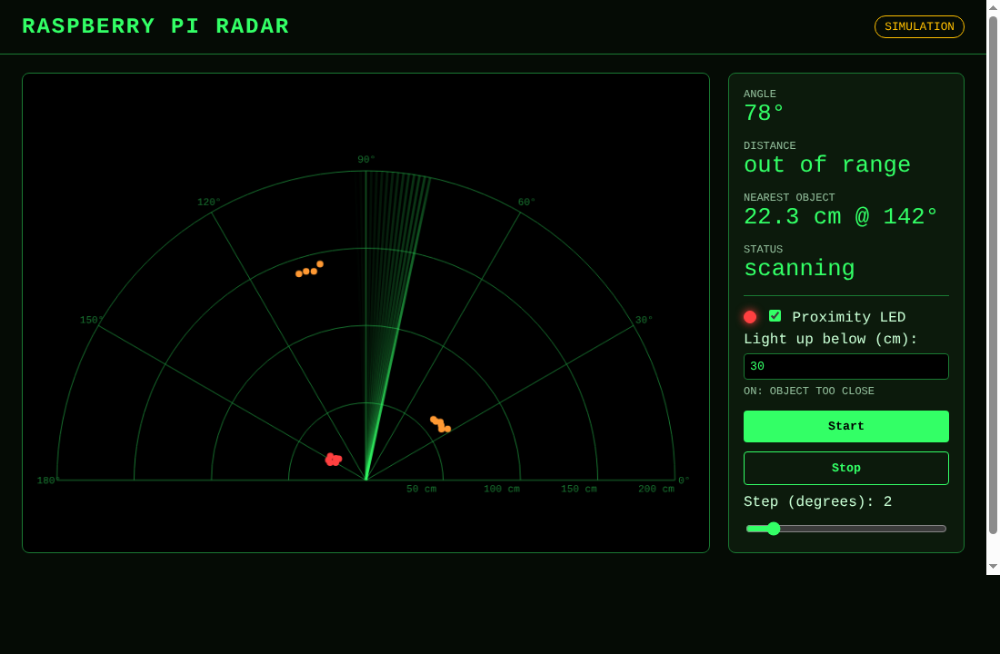

# Raspberry Pi Radar (IoT Lab Mini Project)



An ultrasonic sensor mounted on a servo sweeps 0°–180°. A Python Flask backend on the Pi reads the
distance at every angle and serves it as JSON. An HTML/CSS page (with a little JavaScript for the canvas)
draws a live radar screen. Apache serves the whole app through mod_wsgi.
An optional LED lights up when something comes closer than a distance you set.

Tested for Raspberry Pi OS Bookworm (or newer) on Raspberry Pi 3B+, 4 and 5.

## 1. Plan

| Phase | What you do | Output |
|---|---|---|
| 1. Hardware | Wire servo + HC-SR04 to the Pi, test each part alone | Servo turns, sensor gives cm |
| 2. Backend | Flask app + background sweep thread + JSON API | `/api/scan` returns readings |
| 3. Frontend | HTML page, CSS radar theme, canvas drawing | Live radar screen in browser |
| 4. Deployment | Install Apache + mod_wsgi, point it at the app | Open `http://<pi-ip>/` on any device |
| 5. Demo/report | Place objects at known distances, compare readings, screenshots | Lab report |

### Architecture

```
 HC-SR04 ─┐                 ┌──────────── Raspberry Pi ─────────────┐
          ├─ GPIO ─► radar/hardware.py ─► radar/scanner.py (thread) │
 SG90 ────┘                 │                  │                    │
                            │            app.py (Flask)             │
                            │                  │ mod_wsgi           │
                            │              Apache :80               │
                            └──────────────────┼────────────────────┘
                                               │ HTTP (JSON every 100 ms)
                                   Browser: index.html + style.css + radar.js
```

### API

| Method | URL | Purpose |
|---|---|---|
| GET | `/` | Radar web page |
| GET | `/api/scan` | `{angle, distance, running, simulated, max_distance, points:[{angle,distance}], nearest}` |
| POST | `/api/control` | `{"action":"start"}`, `{"action":"stop"}`, `{"action":"speed","step":1-10}`, `{"action":"led","enabled":true,"threshold":30}` |
| GET | `/api/health` | App is up, whether it's simulated, and which GPIO pin library gpiozero picked |

`/api/scan` also returns `led: {enabled, threshold, on}`.

## 2. Components

- Raspberry Pi (3B+/4/5) with Raspberry Pi OS
- HC-SR04 ultrasonic sensor
- SG90 (or MG90S) micro servo
- Resistors: 1 kΩ and 2 kΩ (or 2 × 1 kΩ in series for the 2 kΩ)
- Breadboard and jumper wires
- Optional: separate 5 V supply for the servo (recommended, stops the Pi from browning out)
- Optional: one LED (any colour) and a 330 Ω resistor for the proximity warning

## 3. Wiring

| Part | Wire | Pi pin (physical) | BCM GPIO |
|---|---|---|---|
| Servo | Brown/black (GND) | Pin 6 (GND) | – |
| Servo | Red (5 V) | Pin 2 (5 V) or external 5 V | – |
| Servo | Orange (signal) | Pin 12 | GPIO18 |
| HC-SR04 | VCC | Pin 4 (5 V) | – |
| HC-SR04 | GND | Pin 14 (GND) | – |
| HC-SR04 | TRIG | Pin 16 | GPIO23 |
| HC-SR04 | ECHO | Pin 18 **through divider** | GPIO24 |
| LED (optional) | Long leg (+) | Pin 11 | GPIO17 |
| LED (optional) | Short leg (−) via 330 Ω | Pin 9 (GND) | – |

**ECHO voltage divider (required).** The HC-SR04 ECHO pin outputs 5 V and the Pi's GPIO is 3.3 V only;
connecting it directly can damage the Pi.

```
 HC-SR04 ECHO ──[ 1 kΩ ]──┬──► GPIO24 (pin 18)
                          │
                       [ 2 kΩ ]
                          │
                         GND
   5 V × 2k / (1k + 2k) = 3.3 V
```

If you use an external 5 V supply for the servo, connect its GND to the Pi's GND (common ground).

**LED (optional):** GPIO17 → LED long leg → LED short leg → 330 Ω → GND. The resistor limits the current;
without it the LED or the pin can burn out. The pin isn't touched until you enable the LED, so it's safe to leave unwired.

Mount the HC-SR04 on the servo horn (hot glue or a small bracket) so it rotates with it.

## 4. Project files

```
iot-radar/
├── app.py                 Flask app and API routes
├── radar/
│   ├── config.py          pins, sweep speed, LED settings (all overridable)
│   ├── hardware.py        gpiozero servo + sensor + LED, and SimHardware fake
│   └── scanner.py         background sweep thread 0→180→0, LED logic
├── templates/index.html   page layout
├── static/style.css       radar theme
├── static/radar.js        polls /api/scan, draws the canvas
├── radar.wsgi             mod_wsgi entry point
├── apache/iot-radar.conf  Apache virtual host
├── tests/test_radar.py    tests using gpiozero's mock pins (no Pi needed)
└── requirements.txt
```

## 5. Step-by-step setup

### Step 1: Prepare the Pi

```bash
sudo apt update && sudo apt full-upgrade -y
sudo apt install -y python3-flask python3-gpiozero python3-lgpio apache2 libapache2-mod-wsgi-py3
```

Use the apt packages, not pip. Bookworm blocks system-wide `pip install`, and Apache's Python only sees
apt-installed libraries without a virtualenv.

`python3-lgpio` is the pin library gpiozero uses on current Raspberry Pi OS. It's the only one that works on a
Pi 5 (RPi.GPIO and pigpio don't support the Pi 5's new GPIO chip). On a Pi 3/4 it works too, so the same code
runs everywhere. Check which library was picked at `/api/health` (`"pin_factory": "LGPIOFactory"`).

### Step 2: Test the hardware alone

```bash
python3 -c "
from gpiozero import AngularServo, DistanceSensor
from time import sleep
s = AngularServo(18, min_angle=0, max_angle=180, min_pulse_width=0.0005, max_pulse_width=0.0024)
d = DistanceSensor(echo=24, trigger=23, max_distance=2)
for a in (0, 90, 180, 90):
    s.angle = a; sleep(0.6); print(a, round(d.distance*100, 1), 'cm')
"
```

If the servo doesn't reach the ends, adjust `min_pulse_width` / `max_pulse_width` in `radar/hardware.py`.
If it jitters a little, that's lgpio's software PWM timing. It's fine for a demo. On a Pi 3/4 (not 5) you can use
pigpio for steadier pulses: `sudo apt install pigpio python3-pigpio && sudo systemctl enable --now pigpiod`, then
set `GPIOZERO_PIN_FACTORY=pigpio`.

Test the LED (optional): `python3 -c "from gpiozero import LED; from time import sleep; l=LED(17); l.on(); sleep(2)"`

### Step 3: Run with Flask's dev server first

Get the code onto the Pi (the folder must be called `iot-radar` for the commands below):

```bash
git clone https://github.com/vedantmade/Raspberry-Pi-Radar.git ~/iot-radar
```

Then:

```bash
cd ~/iot-radar
python3 app.py                    # real sensor
RADAR_SIMULATE=1 python3 app.py   # no hardware needed (also works on your laptop)
```

Open `http://<pi-ip>:5000` (find the IP with `hostname -I`). You should see the radar sweeping.
On a laptop: `pip install flask` then `RADAR_SIMULATE=1 python app.py`.

### Step 4: Deploy on Apache

```bash
# 1. Copy the app to the web root
sudo cp -r ~/iot-radar /var/www/iot-radar
sudo chown -R www-data:www-data /var/www/iot-radar

# 2. Let Apache's user use the GPIO pins
sudo usermod -aG gpio www-data

# 3. Enable mod_wsgi and the site, disable the default page
sudo a2enmod wsgi
sudo cp /var/www/iot-radar/apache/iot-radar.conf /etc/apache2/sites-available/
sudo a2ensite iot-radar
sudo a2dissite 000-default
sudo apachectl configtest
sudo systemctl restart apache2
```

Stop any `python3 app.py` you started in Step 3 first, since only one program can drive the GPIO pins.

Open `http://<pi-ip>/` from any device on the same network.

**Logs if something fails:** `sudo tail -f /var/log/apache2/iot-radar-error.log`

**Demo without hardware under Apache:** set `RADAR_SIMULATE` to `"1"` in `radar.wsgi` and restart Apache.

**Check it's really using the GPIO:** `curl http://localhost/api/health` should show `"simulated": false`.
If it says `true`, the error log says why (usually a permission problem, see Troubleshooting).

### Optional: proximity LED

The LED is **off by default**. Turn it on either way:

- **From the web page:** tick *Proximity LED* and set *Light up below (cm)*. This lasts until Apache restarts.
- **Permanently:** in `radar.wsgi` set `RADAR_LED_ENABLED` to `"1"` and `RADAR_LED_THRESHOLD_CM` to your distance,
  then `sudo systemctl restart apache2`. For `python3 app.py`, use `RADAR_LED_ENABLED=1 RADAR_LED_THRESHOLD_CM=40 python3 app.py`.

The LED stays on while anything in the latest sweep is closer than the threshold, and goes off once the
sweep passes that angle again with nothing there. Close objects are also drawn red on the radar.

### Settings

Everything lives in `radar/config.py` and can be overridden with environment variables
(under Apache, set them in `radar.wsgi`):

| Variable | Default | Meaning |
|---|---|---|
| `RADAR_SIMULATE` | `0` | `1` = fake hardware |
| `RADAR_SERVO_PIN` / `RADAR_TRIG_PIN` / `RADAR_ECHO_PIN` / `RADAR_LED_PIN` | `18` / `23` / `24` / `17` | BCM pin numbers |
| `RADAR_SERVO_MIN_PULSE` / `RADAR_SERVO_MAX_PULSE` | `0.0005` / `0.0024` | Servo pulse at 0° and 180° (seconds) |
| `RADAR_MAX_DISTANCE_CM` | `200` | Farthest distance shown |
| `RADAR_STEP_DEG` | `2` | Degrees per step |
| `RADAR_SETTLE_S` | `0.08` | Wait after each move before reading |
| `RADAR_LED_ENABLED` | `0` | `1` = use the proximity LED |
| `RADAR_LED_THRESHOLD_CM` | `30` | LED lights below this distance |
| `GPIOZERO_PIN_FACTORY` | auto | Force `lgpio`, `rpigpio` or `pigpio` |

### Running the tests

The tests use gpiozero's mock pins, so they run on a laptop or the Pi without any wiring:

```bash
python3 -m unittest discover -s tests -v
```

### Step 5: Test and record results

1. Place objects at 20, 50, 100 cm at different angles; compare measured vs actual distance in a table.
2. Hit the API directly: `curl http://<pi-ip>/api/scan`.
3. Take screenshots of the radar page for the report.

## 6. Why it's built this way

- **Background thread:** the sweep runs continuously, independent of web requests; the API only reads the latest data.
- **One Apache process (`processes=1`):** each process would start its own sweep thread, and two threads would fight over the servo.
- **Polling every 100 ms:** simple and good enough for a sweep that takes a few seconds; WebSockets would be the next upgrade.
- **Simulation mode:** lets you build and demo the frontend before the hardware is ready, and falls back automatically if GPIO isn't available.

## 7. Troubleshooting

| Symptom | Fix |
|---|---|
| Page says SIMULATION on the Pi | GPIO failed to open. Check the Apache error log. Usual causes: `www-data` not in the `gpio` group (run the `usermod` step, then `sudo reboot`), `python3-lgpio` missing, `/var/www/iot-radar` not owned by `www-data` (lgpio writes small files there), or `python3 app.py` still running and holding the pins |
| "GPIO busy" in the log | Another program is using the pins. Stop it, or `sudo systemctl restart apache2` |
| Radar stuck at one distance | Sensor not answering: check TRIG/ECHO wires and the divider. The sweep keeps running and shows "out of range" |
| LED never lights | Enable it on the page, check the LED's long leg goes to GPIO17, and try the LED test in Step 2 |
| Distance always "out of range" | Check TRIG/ECHO wiring and divider; object may be farther than 200 cm |
| Pi reboots when servo moves | Power the servo from an external 5 V supply with a common ground |
| 500 error from Apache | `sudo tail /var/log/apache2/iot-radar-error.log` |
| CSS/JS not loading | Check the `Alias /static` line and file ownership |

## 8. Possible extensions

- Buzzer next to the LED (gpiozero `Buzzer`, same logic as the LED)
- Log detections to SQLite and show a history page
- WebSockets (Flask-SocketIO) instead of polling
- Replace HC-SR04 with a VL53L0X laser ToF sensor for better accuracy
